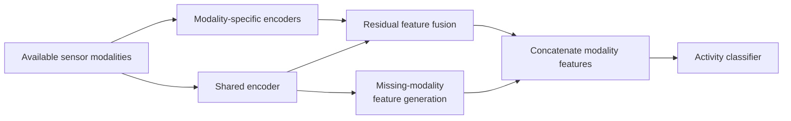

# ShaSpec-HAR

**Shared-specific feature modeling for robust human activity recognition with missing sensor modalities.**

This repository contains the PyTorch implementation and experiment pipeline developed for the 2024 bachelor's thesis *Improving Robustness in Human Activity Recognition: Shared-Specific Feature Modeling for Missing Modalities*. The project adapts ShaSpec to multivariate wearable-sensor data and evaluates its robustness when complete sensor devices or modalities are unavailable.

The implementation supports the [Daily and Sports Activities Dataset (DSADS)](https://archive.ics.uci.edu/dataset/256/daily%2Band%2Bsports%2Bactivities) and the [REALDISP Activity Recognition Dataset](https://archive.ics.uci.edu/dataset/305/realdisp%2Bactivity%2Brecognition%2Bdataset), subject-disjoint cross-validation, configurable modality miss rates, and component ablations.

## Approach

ShaSpec learns two complementary representations for every available sensor modality:

- A **specific encoder** captures information unique to that modality.
- A **shared encoder** captures information common across the available modalities.
- A **residual fusion block** combines the specific and shared representations.
- When a modality is missing, its representation is approximated by averaging the available shared features.
- A fully connected decoder combines all modality representations and predicts the activity class.



Each encoder uses four temporal convolution layers, self-attention for cross-channel interaction, and a fully connected feature-fusion layer. The model definition is in [`models/ShaSpec.py`](models/ShaSpec.py), with its main hyperparameters in [`configs/model.yaml`](configs/model.yaml).

## Thesis results

The thesis compares ShaSpec-HAR with Augmented Adversarial Learning for HAR (AALH). Values below are mean accuracy across the reported experiments; standard deviations are shown in parentheses.

| Dataset | Missing modalities | ShaSpec-HAR | AALH |
| --- | ---: | ---: | ---: |
| DSADS | 0% | 86.2% (3.7) | 93.4% (1.6) |
| DSADS | 20% | 86.7% (2.8) | 90.5% (4.2) |
| DSADS | 40% | 87.8% (3.7) | 87.4% (3.9) |
| DSADS | 60% | **85.1% (2.3)** | 76.2% (8.4) |
| REALDISP | 0% | 93.4% (2.7) | 97.9% (0.6) |
| REALDISP | 10% | 92.9% (3.2) | 97.1% (0.8) |
| REALDISP | 30% | 93.4% (2.4) | 95.5% (1.6) |
| REALDISP | 50% | **91.9% (1.9)** | 90.8% (2.7) |
| REALDISP | 70% | **82.9% (3.5)** | 75.3% (4.0) |

The main finding is robustness rather than peak full-data performance. At the highest evaluated miss rates, ShaSpec-HAR exceeds the AALH baseline by 8.9 percentage points on DSADS and 7.6 points on REALDISP. Relative to its own full-data accuracy, it retains 98.7% on DSADS at a 60% miss rate and 88.8% on REALDISP at a 70% miss rate.

The AALH implementation was not publicly available, preventing reproduction of its published results under an identical setup. The absolute cross-model comparison should therefore be interpreted with this limitation in mind.

## Datasets and preprocessing

| Dataset | Sampling rate | Subjects used | Activities | Modalities | Channels per modality | Window | Evaluated miss rates |
| --- | ---: | ---: | ---: | ---: | ---: | ---: | --- |
| DSADS | 25 Hz | 8 | 19 | 5 body locations | 9 | 5 s | 0.0, 0.2, 0.4, 0.6 |
| REALDISP | 50 Hz | 16 of 17 | 33 | 9 body locations | 13 | 3 s | 0.0, 0.1, 0.3, 0.5, 0.7 |

The pipeline standardizes sensor channels, creates overlapping temporal windows, and performs four-fold subject-disjoint cross-validation. Training windows use 50% overlap; test windows use 90% overlap. For every batch, the requested number of modalities is selected randomly and omitted.

Download the datasets from UCI and arrange them as follows:

```text
datasets/
├── DSADS_Dataset/
│   ├── a01/
│   │   ├── p1/
│   │   │   ├── s01.txt
│   │   │   └── ...
│   │   └── ...
│   └── ...
└── REALDISP_Dataset/
    ├── subject1_ideal.log
    ├── subject2_ideal.log
    └── ...
```

To reproduce the thesis setup for REALDISP, place only `subject1_ideal.log` through `subject16_ideal.log` in `REALDISP_Dataset`. The loader reads every matching `.log` file in that directory; self-placement and mutual-displacement files would therefore change the experiment.

Dataset names, channel layouts, sampling rates, and window sizes are defined in [`configs/data.yaml`](configs/data.yaml).

## Installation

Python 3.10 and a CUDA-capable PyTorch installation are recommended. The project was developed locally with Python 3.10.12 and PyTorch 2.0.1; final experiments ran with Python 3.9.13 and PyTorch 1.9.1 on an NVIDIA Tesla V100 32 GB GPU.

```bash
git clone https://github.com/probstlukas/shaspec-har.git
cd shaspec-har

python3 -m venv .venv
source .venv/bin/activate
python -m pip install --upgrade pip
python -m pip install torch numpy pandas scikit-learn matplotlib seaborn pyyaml tqdm jupyter
```

[`requirements.txt`](requirements.txt) is a snapshot of the original development environment. It contains machine-local package references and does not include PyTorch, so it is not a portable lock file.

Create directories for cached sliding-window indices and experiment logs:

```bash
mkdir -p ../Sliding_window ../Run_logs
```

## Running an experiment

Run commands from the repository root because configuration paths are relative to it.

For example, train and evaluate ShaSpec on DSADS with a 40% modality miss rate:

```bash
python main.py \
  --data-name dsads \
  --model-type shaspec \
  --miss-rate 0.4 \
  --root-path ../datasets \
  --window-save-path ../Sliding_window \
  --to-save-path ../Run_logs \
  --shuffle \
  --seed 1
```

For REALDISP, replace `--data-name dsads` with `--data-name realdisp` and select one of the miss rates configured for that dataset.

Useful options include:

| Option | Purpose |
| --- | --- |
| `--miss-rate FLOAT` | Fraction of modalities to omit; the count is rounded up. |
| `--seed INT` | Random seed for training and modality selection. Thesis results use seeds `1` and `42`. |
| `--batch-size INT` | Batch size; defaults to `128`. Reduce it if GPU memory is limited. |
| `--train-epochs INT` | Maximum number of epochs; defaults to `60`. |
| `--activation ReLU\|Tanh` | Encoder activation function. |
| `--ablate-shared-encoder` | Remove the shared encoder and use noise for missing features. |
| `--ablate-missing-modality-features` | Replace generated missing-modality features with Gaussian noise. |

The default experiment mode is four-fold subject-group cross-validation (`LOCV`). Each run creates a directory such as:

```text
../Run_logs/logs/model_shaspec_data_dsads_seed_1_miss_rate_0.4_.../
├── config.json
├── score.txt
├── cv_0/
│   ├── epoch_log.txt
│   └── final_best_vali.pth
└── ...
```

`score.txt` contains per-fold metrics and their mean and standard deviation. The reported metrics include accuracy and weighted, macro, and micro F1 scores.

### SLURM

[`main.py`](main.py) includes the original SLURM directives. [`template.sh`](template.sh) lists the full dataset, miss-rate, seed, and ablation experiment grid. On a compatible cluster, submit that grid with:

```bash
bash template.sh
```

Adjust the cluster-specific partition, paths, email address, and resource directives in `main.py` before submitting jobs.

## Notebooks

| Notebook | Purpose |
| --- | --- |
| [`train_ShaSpec.ipynb`](train_ShaSpec.ipynb) | Configure and start an experiment interactively. |
| [`test_ShaSpec.ipynb`](test_ShaSpec.ipynb) | Build the model and run a forward pass with synthetic multimodal input. |
| [`generate_sh.ipynb`](generate_sh.ipynb) | Regenerate the SLURM experiment grid in `template.sh`. |
| [`extract_results.ipynb`](extract_results.ipynb) | Parse experiment logs and aggregate results across seeds. |
| [`plot_results.ipynb`](plot_results.ipynb) | Plot accuracy, robustness, and ablation comparisons. |

## Repository structure

```text
.
├── configs/            # Dataset and model hyperparameters
├── dataloaders/        # DSADS/REALDISP readers, windows, and CV splits
├── models/             # ShaSpec, self-attention, and model builder
├── experiment.py       # Training, validation, checkpoints, and metrics
├── main.py             # Command-line and SLURM entry point
├── template.sh         # Full SLURM experiment grid
└── *.ipynb             # Training, testing, aggregation, and plotting workflows
```

## Acknowledgements

This work adapts the original ShaSpec method described by Hu Wang et al. in [*Multi-modal Learning with Missing Modality via Shared-Specific Feature Modelling*](https://arxiv.org/abs/2307.14126) for the requirements of wearable-sensor HAR.
